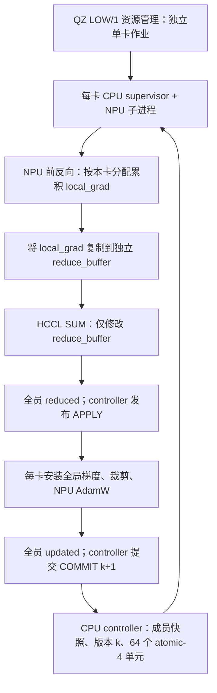
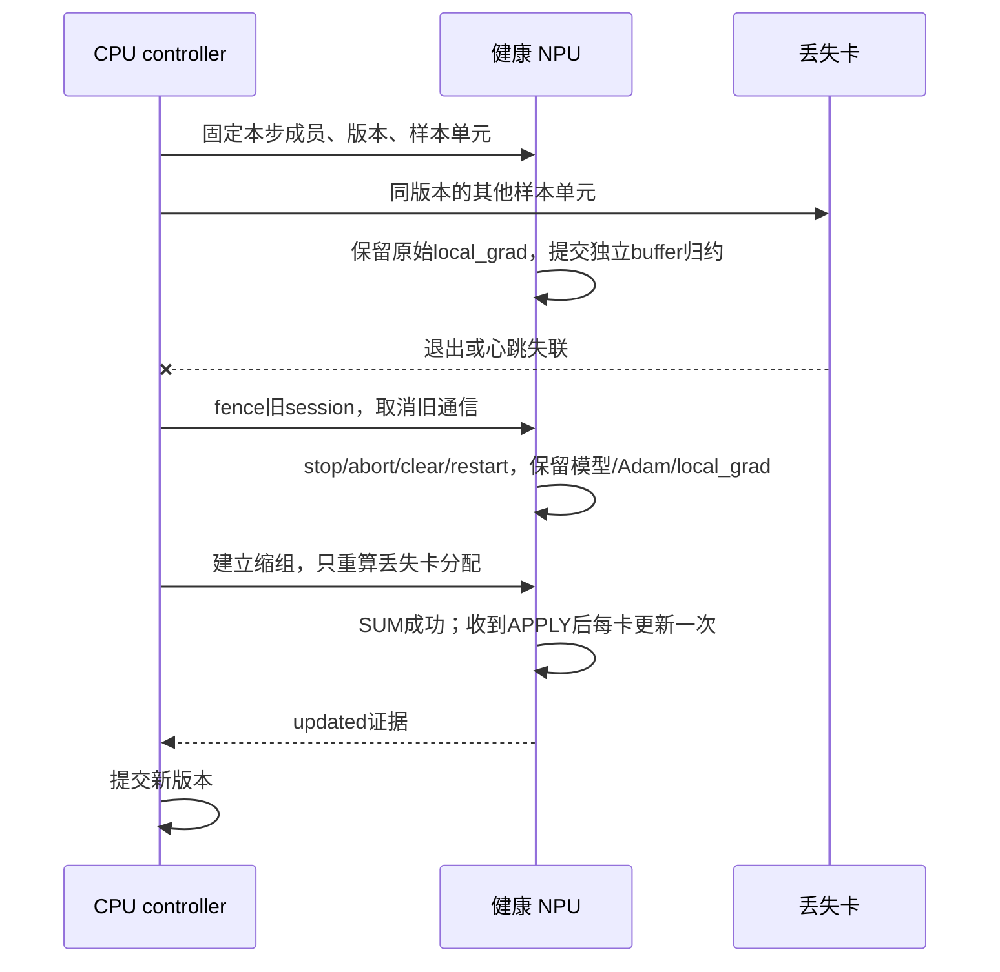

# 一步训练与掉卡恢复

每个 LOW/1 平台作业独立申请一张卡，CPU supervisor 管理自己的训练子进程。CPU controller 决定本步成员与样本位置，模型、局部梯度和原生 AdamW 状态常驻每张 NPU。平台调度和训练成员是两套状态：平台作业 running 不等于训练 READY。

当前复用路径明确固定 **global batch 256、atomic unit 4、关闭梯度重算、原生 torch.optim.AdamW**。支持 2–64 个初始成员。要改变 global batch、优化器或状态精度，需要修改并验证相应合同，不能只改一个配置数字。



通信前先完成本地反传，当前路径没有 DDP 式反传/AllReduce 重叠。CPU 管样本、成员和控制文件，不做中央大模型梯度归约或 Adam。共享文件系统存控制与 checkpoint；正常每步的大梯度经 HCCL 设备通路传播。

## 样本权重不能依赖当前卡数

一次更新总是覆盖 64 个 atomic-4 单元。例如 32 卡时每卡 2 个单元、8 个样本；64 卡时每卡 1 个单元、4 个样本。物理 microbatch 可为 4，更小 microbatch 通过累积达到相同本卡贡献。

设第 r 张卡的样本集合为 S_r。adapter 反传的是 `sum(loss_i for i in S_r) / 256`；如果模型返回 microbatch 均值，则乘 `microbatch实际样本数 / 256`。随后 HCCL 执行 **SUM**，不能再除 world_size。掉卡后样本分配不均匀，这一点尤其关键。

```text
2 卡：A 计算128样本/256，B计算128样本/256
全局梯度 = g_A + g_B
若B失联：保留g_A，A只补B对应128样本；得到相同256样本贡献。
不能对已经被失败AllReduce原位改写的梯度继续补算。
```

## 一张卡在 APPLY 前失联



这条恢复会暂停当步；不能描述为掉卡完全无停顿。设备恢复依赖已验证的 torch_npu/CANN 后端 API，换版本后先做小组故障测试。当前控制流只支持一次 APPLY 前的成员失联，修复中再次丢卡等情况不会自动无限缩组。

## 替补入组与 checkpoint

替补先独立 LOADING，不属于当前训练成员。初始模型加载可以和健康组训练并行；入组边界要暂停，传递并校验完整状态，再建立新组。需要模型全部参数（含冻结/共享别名）、buffers、Adam moments、每参数 step、optimizer groups/defaults、提交版本与随机性合同。只加载权重不足以恢复 Adam。

本实现的原生状态使用参数本来的 dtype：BF16 参数配 BF16 moments，FP32 参数配 FP32 moments，没有额外 FP32 master。这不能自动等价于别人的 FP32-master 优化器。

一旦 APPLY 已授权，部分卡可能已更新。当前通用控制流不能简单缩组、重放再更新，否则可能双重 apply；它应以明确失败结束，保留最后完整 checkpoint。控制器进程崩溃也不是无状态重启即可继续的情形。详见 [边界](05_evidence_and_limits.md)。
