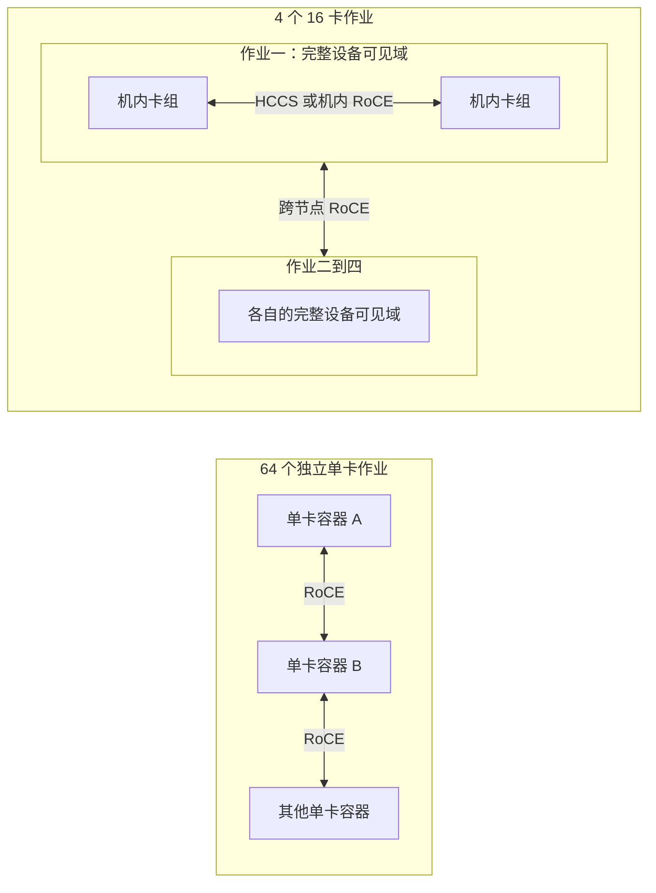
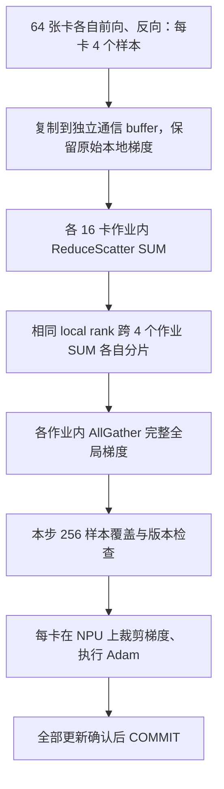
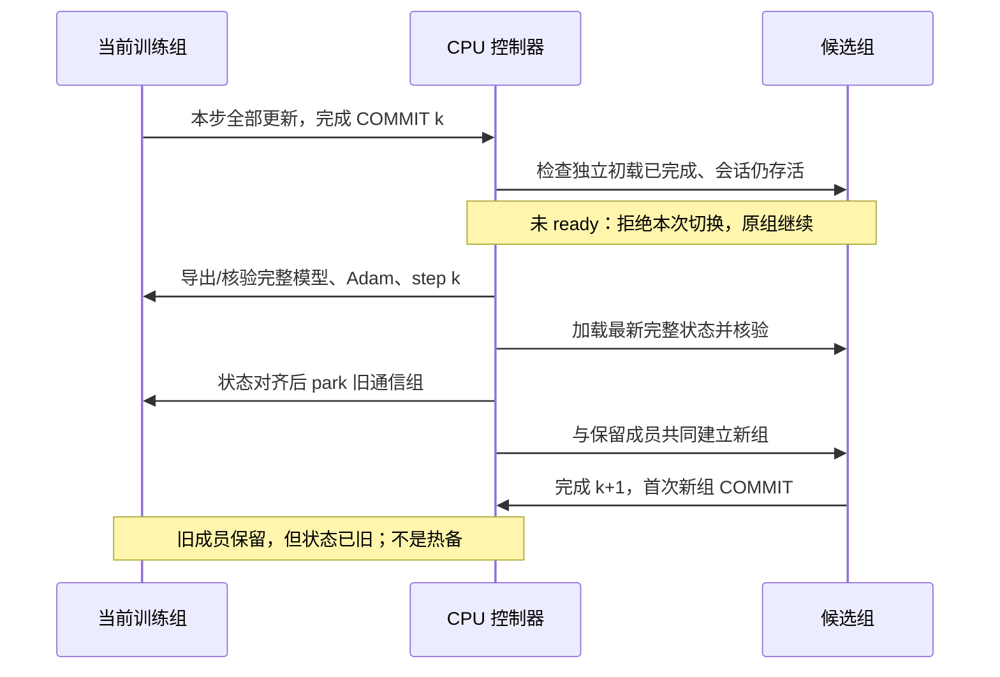

# 整机与碎卡混合训练：实现、实验与边界

本页对应 `feature/topology-aware-training`，2026-11-07 完成这一轮有界实验验收。已通过节点规划、多卡通信对照、600 步小模型自动切入/定时切回和 64 卡 OpenPI 30 步短训。任意新作业持续加入、整 pod 被抢占后的自动恢复仍未完成，不能据此宣称全自动低优训练已经生产就绪。

## 为什么整机申请会改变通信

“16 张卡在同一物理机器上”和“一个作业看到这 16 张卡”不是同一条件。设备可见性、容器 IPC 权限与 HCCL 识别出的通信域都会影响路径。历史 64 个单卡容器虽然有部分共用物理节点，HCCL 仍记录 `serverNum=64`、`HccsNum=0`，设备通信分析没有发现 HCCS 字节。不能通过伪造 rank table 的 server ID 解决隔离问题：历史同机双卡试验发现 HCCS 后仍因对端设备 IPC notify 不可访问而失败。

本次真实 LOW/1 的 16 卡作业保留平台分配的完整可见设备集合，用 16 个进程分别选择逻辑设备 0–15。HCCL 日志记录 `serverNum[1] moduleNum[2]`，并出现实际 `transporttype[HCCS]` 和 `transporttype[ROCE]` 的建链记录。因此一个 16 卡作业内部也不保证所有边都走 HCCS；跨机内模块仍可能使用 RoCE。



这里的优化首先是申请和进程布局。对同一组完整设备调用一次 HCCL AllReduce，HCCL 本身就可能选用层次算法。不能把 API 上一次 AllReduce 叫作“物理网络完全平坦”，也不能仅依据 `INTRA_ROCE_ENABLE=1` 或 `SetupAgent` 判定 HCCS 不工作。

## 按节点规划资源

`topology.py plan` 调用平台节点视图的官方 `ListNodeDimension` 接口。按查询的 workspace/resource group 保留作用域，跨空间去重物理节点，仅使用新鲜的 `Ready` 记录。16→8→4→2→1 的选择同时核对空闲 NPU、CPU、内存和真实可申请规格；空闲卡不足时才使用预算内的单卡排队意图。

例如一个节点空闲 16 张 NPU，但所选 16 卡规格需要 160 CPU 而只剩 100 CPU，不能申请该规格；若存在 8 卡/80 CPU 规格且内存充足，就可计划 8 卡作业。不能只根据 GPU 空闲数给出“已经可以拿到 16 卡”的结论。

当前两个授权空间均返回 `train_enable_specified_nodes=false`。节点视图可指导选资源组和规格，**不能指定目标物理节点**。计划输出 `binding.status=unbound`、`allocation_verified=false`；实际节点要等官方作业实例分配后核验。禁止虚构 affinity 字段绕过平台设置。

```bash
python topology.py plan --config /shared/private/site.json \
  --output /shared/topology-evidence --cookie-file /shared/private/qz.cookies
python topology.py prepare --config /shared/private/site.json \
  --output /shared/topology-evidence --run-dir /shared/new-run \
  --cookie-file /shared/private/qz.cookies
python launch.py run --run-dir /shared/new-run --cookie-file /shared/private/qz.cookies
```

prepare 冻结本轮 `job_layout` 和精确 `job_selections`，不提交作业。`topology.py watch` 持续查询资源，默认只读；`--fill` 仅创建这轮尚未提交的固定槽位。它**不会把新发现的任意作业自动接入正在训练的组**，也不会停止训练。账本在规划途中变化时，本轮拒绝生成可执行计划，后续重新读取；不能把混合时刻的读数当作预算证明。

若已有计划的候选池，site 可设置 `defer_standby_until_idle=true`。初始 active 必须结束在完整作业边界。launcher 先申请初始组，至少完成一个 COMMIT 后才查询空闲节点；有足够 NPU/CPU/内存才提交后续固定候选规格，不把候选提前加入训练，也不在没有空闲时为候选排队。查询失败只推迟候选，原训练继续。每轮候选查询位于现有共享预算锁内，最新证据在 run 的 `topology_allocation/latest.json`。

每轮新鲜观测最多产生一个候选；上一候选仍在排队或分配未知时，不再用尚未反映其占用的节点读数重复申请。共享预算仍累计所有预留。一个 run 的意图读取、计划构造和提交使用同一短锁，避免 launcher 与 `watch --fill` 同时读取旧槽位索引。预算锁忙属于可重试观测，不触发停止训练；总观察期限仍生效。清理先请求停止本 run 的作业，只有官方活动和预留均为零才停止自有控制器。锁一直忙到清理期限时，回执明确标记尚未释放、控制器停止已推迟，需要重试。

`candidate_watch.py` 独立检查候选的官方 LOW/1 running 状态、实际实例节点、完整作业设备域、READY 和 supervisor 会话，再建议用较大的作业替换等卡数的多个完整小作业。默认只读，`--apply` 才提交带版本 fence 的未来 COMMIT 请求。它不申请/释放资源，优先保留 rank 0；打包改善是性能假设，不是吞吐保证。

```bash
python candidate_watch.py --run-dir /shared/new-run --seconds 600 \
  --interval 0.2 --apply --max-switches 1 --lead-steps 5
```

例如 `cards=6, active_cards=4, job_layout=[1,1,1,1,2]`：先四个单卡训练，再申请一个双卡候选作业，全部就绪后替换其中两个单卡作业的训练成员。两个退出训练的单卡仍被保留，不能称作已释放或最新热备。监视器只有限重试已明确拒绝的自有请求，不覆盖其他 writer、处理中或已完成的请求。持续复用释放后的槽位、不断接入任意新 job 仍未实现。

共享预算默认是 `registered_fleets`：累计已登记实验 fleet 的活动、候选、保留成员、排队与未知提交。账号下其他项目作业单独披露，并已体现在节点空闲资源中。`budget_scope=account` 可在只读规划中额外计入所查询两个空间的外部作业，未知占用则拒绝规划；当前拒绝这个模式的 prepare/run/补卡执行，因为执行锁内尚未实现原子化的账号总额核算，不能把账户余量检查冒充实际提交约束。报告预算时必须说清范围。

## 一步更新中的两级 SUM

均匀的 4×16 卡组可以显式执行以下流程。每个 NPU 仍保存完整模型和自己的 Adam 状态，梯度已按每样本 1/256 加权；任何层都不再除以组数或卡数。



以 6.74 GB 梯度为例，均匀 16 卡作业的每个分片约 0.421 GB，跨组阶段由 16 条对应 local-rank 的组共同承担，随后在本作业内恢复完整梯度。实际耗时还受网卡共享、物理拓扑、HCCL 算法和分片串行依赖影响。不能笼统说“跨机字节降低 16 倍”：全局 ring 按节点连续排列时，本来就只在少数节点边界跨机。

不等大小的作业不能简单拼成上述相同分片结构。实验实现支持组内 SUM→leader 间 SUM→组内广播，或退回默认 AllReduce；leader 承担完整梯度可能反而变慢。`TopologyCollective` 是固定成员通信实验，尚未替换生产 resident controller 的归约与故障恢复路径。

## timeout 到底改变了什么

这里要区分三个量：RDMA 重传计时、一次 HCCL 操作的执行上限、控制器等待成员的时间上限。历史降速诊断修改的是 `HCCL_RDMA_TIMEOUT` 指数，不是每一步主动 sleep 的时间。

以常见 RDMA 编码 `4.096μs × 2^n` 举例，n=16 对应约 268.435 ms，n=12 对应约 16.777 ms。正常及时确认的消息不会等满这个时限；当某个传输片段需要超时驱动的重试/恢复时，较大指数可能把一次停顿拉长。一个 13 桶归约中若若干关键链路反复发生这种停顿，最终完成时间会累积变慢。若没有触发这些条件，仅把指数调小不应让传输带宽凭空增长。

历史同卡实验：NHR/16 完整序列约 6.533 s，NHR/12 约 1.362 s；但缩短 timeout 后端口 retry 与 PSN 计数没有消失，甚至更多。统计窗口并非等长，且并非每个 QP 的独立计数，不能据此直接推导丢包率或认定所有重试由本进程造成。更小不等于更好：可能增加不必要重试、负载和失败概率，需要在对应通信拓扑上实测。

4×16 也跨机，但通信图、IPC 可用性、机内路径、并行传输量和算法不同。更少的独立服务器端点不意味着“只减少报错概率”；它会改变正常数据路径本身。整机布局下 timeout 是否仍敏感，要看同一批设备上的 16→12→16 对照，不能直接外推历史单卡容器结果。

## 候选加载与切换

当前已接入的是**预先授权且数量有界的 resident 槽位**。例如 `cards=6, active_cards=4, job_layout=[2,2,2]`：前四张参与训练，后两张独立加载。初载未完成时不加入本步，也不要求原训练等候。配置中的 `resident_topology_switches` 或带 run/config/step/generation fence 的外部请求，在 COMMIT 边界尝试替换等量成员。



“模型初载好了”不等于“能从 k+1 正确继续”。候选还必须得到最新参数、Adam 一二阶矩、步数与学习率配置。切回旧成员也要重新对齐这些状态。

旧 16 卡在新组第一次 COMMIT 后有两种选择：释放，则不能保证下次抢占时仍拿得到；保留，则占预算，且状态每步变旧。只有持续同步完整训练状态才是真正可直接顶上的热备，本版没有宣称做到这一点。在 64 卡实验总预算下，64 活跃+16 候选不合法；需要例如 48 活跃+16 候选，或另行取得更大预算。

尚未实现任意新作业不断加入、整 pod 多成员突然失联的自动回切、APPLY 中途任意故障恢复。历史单卡 pre-APPLY 补算验收不能覆盖整个 16 卡 pod 被收回。把多卡部署作为长期低优训练默认值之前，必须补完这些恢复分支及对应故障实验。

## 验收记录

本次 4×16、64 卡、13 桶共 6,736,577,376 字节，按默认/分层/默认测量，每个模式预热 3 次、正式 10 次；同一批卡用新进程执行 timeout 16→12→16。所有 rank 的完整输出和源 buffer 保留检查通过，192 份报告齐全，4 个作业均官方成功终态。以下是完整桶序列的最大 rank 时间均值，排除源数据拷贝、控制同步和验证成本。

| 同批 4×16 卡 | 默认 HCCL 第一次 | 显式两级分层 | 默认 HCCL 复测 |
|---|---:|---:|---:|
| timeout 16 | 0.10782 s | 0.14089 s | 0.10737 s |
| timeout 12 | 0.10866 s | 0.14075 s | 0.10771 s |
| timeout 16 再次 | 0.10839 s | 0.14178 s | 0.10680 s |

结论是优先打包作业并让默认 HCCL 使用机内路径。这批卡上手工分层增加约 30%–33% 通信时间，缩短 timeout 则没有可见收益。HCCL 全局组日志记录 `rankSize[64] serverNum[4] moduleNum[8]`，实际建链同时出现 HCCS 和 RoCE。当前物理卡 ID 未由官方接口完整提供，不能将作业节点/可见卡数证据改写成逐物理设备 ID 的官方核验。

该基准逐桶 `Work.wait` 建立依赖后统一设备同步，与历史 13 桶全部先异步提交的调度并不完全相同；历史数字只能辅助参考。当前环境的 64 单卡对照使用同一新基准以减少这一差别。任何纯通信结果都不是 OpenPI 整步耗时。

64 个单卡作业对照也全部通过，官方 64 作业成功且释放。实际落在 5 个物理节点，每节点卡数为 16/16/12/12/8；HCCL 却仍记录 `rankSize[64] serverNum[64] moduleNum[64]`，rank 0 建链日志只出现 RoCE。相同单卡组的 timeout 16→12→16 分别为 **5.17872 / 1.01149 / 7.49036 s**。这个复测同时说明降速可复现、时间有明显波动，不能用单个点估计稳定带宽。

在 timeout=12 时，本轮 packed64 默认归约约为独立单卡的 **1/9.35**。两种布局分配到的物理设备并非相同，所以这是当前两批资源的观测对照；不能把 9.35 倍当成每个模型、每组节点的保证。它支持共享设备域和机内路径是主要优化方向，不能把全部差异简单归因于重试概率。

### 实际 OpenPI 整步训练

采用本项目冻结的 resident 运行时与显式提供的 OpenPI 源码、标准 LIBERO 数据和基座权重，4 个 16 卡 LOW/1 作业完成 30 次更新；每卡 batch 4、global batch 256、梯度不重算，Adam 在每张 NPU 上执行。学习率配方保留 warmup 200、peak 5e-5、decay 20,000、end 5e-6。排除前 5 步后，第 6–30 步结果如下。

| 指标 | 实测 |
|---|---:|
| 更新自身均值（下发本步到收齐 updated） | 1.75282 s |
| 实际 COMMIT 间隔均值 / 中位数 | **1.76700 / 1.74980 s** |
| COMMIT 间隔 P95 / 最大值 | 1.84884 / 1.95311 s |
| 每步最大 rank 前反向时间的均值 | 0.54520 s |
| 每步最大 rank 通信区间的均值 | 0.43236 s |
| 每步最大 rank 安装梯度、裁剪和 Adam 时间的均值 | 0.26215 s |

通信区间包含真实训练中各 rank 到达归约的时间差与归约依赖，不能等同于独立通信基准的 0.108 s。不同阶段最大值可能属于不同 rank，也有等待重叠，不能把该表直接相加当作一条串行关键路径。当前没有 DDP 式反向与通信重叠，进一步优化应关注这些剩余控制等待与调度成本；在打包通信对照中，继续缩短 RDMA timeout 没有显示收益。

历史独立单卡 2,000 步窗口的提交间隔约 2.732 s，本轮短训约 1.767 s，观测吞吐提高约 1.55 倍、每步耗时降低约 35%。历史正式原生 64 卡约 1.694 s，本轮约高 4.3%，已接近其量级。三者资源、时段、训练步窗口不同，本轮是从基座开始的 30 步，历史稳定段是恢复后的长跑；不是同卡、同数据次序的严格性能或效果等价实验。另一个历史 1.661 s 数字来自 32 卡 DDP 短探针，不应标成原生 64 卡成绩。

独立审计确认全部 30 步覆盖 256 样本、无重复/漏算单元、无梯度重算，所有 loss/梯度范数有限，64 卡最终完整模型及 Adam 哈希一致；独立扫描校验 20,946,116,788 字节 checkpoint 的 SHA256。loss 首步 0.09407、末步 0.06838；前/后 5 步均值为 0.09505/0.07302。不同步使用不同样本，下降趋势只能说明短跑表现，不能替代完整梯度 CPU oracle、2,000 步稳定性或 LIBERO 下游评测。4 个作业均官方 `job_succeeded`，64 卡全部释放。详见 [OpenPI 短训审计](../evidence/topology-openpi-packed64-20261107.json)。

整轮控制器用时约 353.1 s：启动到训练准备完成约 95.2 s，首步含编译约 44.2 s，末步后的完整 checkpoint 与 64 卡全状态哈希约 162.7 s。正式稳态步时排除这些成本，但计算短实验的总时间时必须计入；平台终态确认另耗时，不计入该控制器时长。

使用可复现通信基准：

```bash
python examples/run_topology_benchmark.py prepare --config /shared/private/site64.json \
  --benchmark-config /shared/private/benchmark.json --run-dir /shared/collective-run
python examples/run_topology_benchmark.py verify --run-dir /shared/collective-run
python examples/run_topology_benchmark.py run --run-dir /shared/collective-run \
  --cookie-file /shared/private/qz.cookies
```

benchmark 配置示例（这里的小 payload 是初始排障用，不能代替真实大梯度）：

```json
{
  "schema": "topology-benchmark-fleet-v1",
  "modes": ["flat", "hierarchy", "flat"],
  "payload": [{"dtype": "float32", "bytes": "64MiB"}],
  "rdma_timeouts": [16, 12, 16],
  "warmup": 3,
  "iterations": 10,
  "timeout_seconds": 120,
  "hard_timeout_seconds": 600,
  "rendezvous_timeout_seconds": 600,
  "fleet_timeout_seconds": 1800
}
```

`flat` 在此表示一次 API AllReduce，允许 HCCL 内部自行分层；它不是对物理传输图的声明。site 的 `job_runtime_seconds` 应覆盖 fleet timeout。大模型数据输入可用绝对 `payload_json` 路径提供有序的 dtype/bytes 桶列表；prepare 会将内容冻结，不在运行时回读可变列表。

小回归模型的步时仅验证协议成本，不能当作 OpenPI 的吞吐。

OpenPI 实验可设置 `isolate_model_cache=true`，把模型/数据缓存放到新 run 内；容器临时目录保持短路径 `/tmp`，因为 CANN 编译器使用的 Unix socket 有路径长度限制。缓存隔离本身不修改数据集选择。只有明确希望忽略站点环境的 episode 排除列表与 prompt 覆盖时，才另设 `clear_openpi_data_overrides=true`。本次标准 LIBERO 对照显式启用后者；使用自己数据筛选的实验应保持默认 false。

- 一个 16 卡 LOW/1 作业，20 步：loss 4.453125→0.16766047；参数相对 CPU 最大误差 8.94e-8，Adam 最大误差 2.38e-7；16 个最终完整状态一致。稳态更新约 0.2261 s，提交间隔约 0.2466 s；官方资源释放。
- 首轮 4 活跃+2 候选，40 步：候选未及时初载，两个固定切换请求均被拒绝，原 4 卡正常完成。此轮只证明拒绝路径，不记作成功切换；官方资源释放。
- 四张单卡开始、后申请一个双卡候选，LR=0.001，600 步：第 331 步后自动切换，第 332 步首次新组 COMMIT；第 500 步后重新对齐并切回原成员，第 501 步首次返回组 COMMIT。两次对齐/park/建组暂停为 0.6414 s 和 0.5731 s。全部 600 步通过原有 CPU loss/梯度范数参考容差；最终模型与 Adam 全状态通过，参数最大绝对误差 1.31e-5，Adam 最大误差 9.47e-7；loss 4.453125→0.651337385，下降 85.37%。六张资源均官方释放。此轮没有注入突然失联，不能当作整 pod 自动回切验收。见 [切换验收摘要](../evidence/topology-switch-600-20261107.json)。
- 先前 LR=0.05 的 600 步实验虽完成两次切换，但严格 CPU 数值审计失败，保留为失败证据。无切换对照同样在约第 226 步超出阈值；CPU 中改变求和顺序或加入 1 ULP 扰动也可复现。最终验收改用经扰动检查稳定的 LR=0.001，未放宽原有容差。这是小回归样例学习率的修正，不改变 OpenPI 的优化器配方。
- 中断失败同样保留：首次 OpenPI 因长临时路径触发 CANN Unix socket 限制；另一次 OpenPI 与小模型并行申请时，普通资源登记锁冲突被误当致命错误。两者均无有效 OpenPI 更新，资源已清理，不能计作成功实验。
- 最终独立源码副本中 253 项测试通过，含真实进程锁竞争、候选重复申请防护、account 只读边界和 SIGTERM 有界清理；CPU 数值参考与原正常/掉卡归档审计通过。只启用一个 subagent 做边界审查与独立文件修复，由主会话统一验证。保活使用任务专属暂停文件，未停止监控父进程，实验和审计结束后均移除自有暂停文件。
