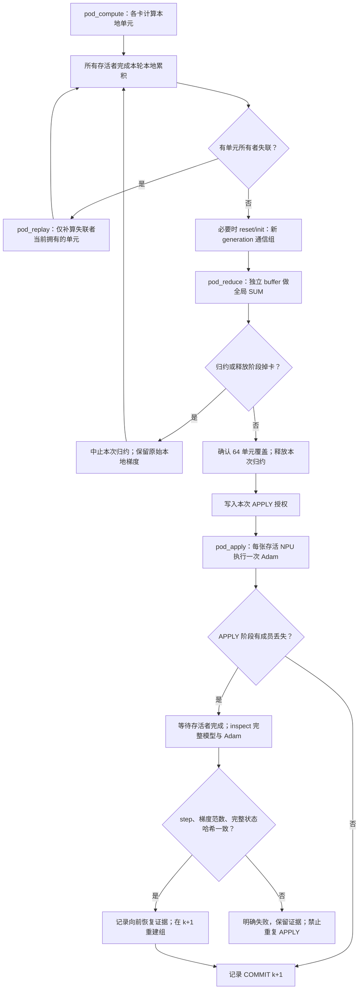

# 整作业与连续掉卡：分阶段恢复协议

本页描述 `resident_pod_recovery` 实验路径：一个多卡作业同时失去多个成员、恢复途中再次掉卡时，保留健康进程的完整模型、Adam 和已完成的本地梯度，缩小通信组后继续当前更新。2026-11-11 已完成真实 QZ 小模型连续整组失联、部分 APPLY 和 checkpoint 导出换源短跑，并通过严格 CPU 数值参考。OpenPI 新路径的独立实测结果另列于本页验收记录；不能直接套用历史成绩。

这里的 pod 指一个平台多卡作业的共同故障域。控制器实际按 `run_id + worker_id + session_id + pid` 确认并封禁失联会话；不会因为两个进程位于同一主机就推断它们必然一起失效。节点规划及正常成员切换见 [09](09_topology_training.md)。

## 启用方式

本页对应 `feature/pod-loss-recovery` 分支；新克隆可用 `git clone --branch feature/pod-loss-recovery https://github.com/dongyingyibadao/fragment_training_kit.git fragment_training_kit`。本路径默认关闭，旧路径及历史证据保留。

先使用已有可运行的 site 配置及模型 adapter。将以下字段合并进去，保留原有 Python、CANN、inventory、registry、数据、优化器和 adapter 配置；这不是完整 site 文件。

```json
{
  "cards": 4,
  "active_cards": 4,
  "job_layout": [2, 2],
  "steps": 20,
  "mode": "external-loss",
  "replacement": false,
  "training_config": {
    "batch_size": 256,
    "disable_activation_checkpointing": true,
    "resident_pod_recovery": true,
    "resident_pod_max_recoveries": 64,
    "resident_pod_step_timeout": 2400,
    "resident_pod_allow_test_holds": false,
    "resident_final_state": "checkpoint"
  }
}
```

`cards == active_cards`，初始为 2–64 个成员；可使用合法的单卡或 1/2/4/8/16 卡作业布局。pod 路径不能同时启用额外候选槽位或 `resident_topology_switches`，也不能启用旧的单卡 replacement。launcher 会生成 `--external-loss --no-replacement`。缩组后允许只剩一名健康成员，global batch 仍为 256。

从项目目录按通常流程执行 `launch.py prepare / verify / run / observe / cleanup`，为每次实验使用新的 run 目录。prepare 冻结运行时和配置；修改源码后不能期待既有 run 自动切换代码。平台预算仍包含活动、候选、排队和未知提交预留。实验前遵循当前工作区的保活暂停/自动退让规则，不停止其他任务。

| 参数 | 实际含义 |
|---|---|
| `resident_pod_recovery` | 默认关闭；显式启用本页分阶段控制器与 worker。 |
| `resident_pod_max_recoveries` | 1–256，默认 64；累计整轮运行的重放/建组恢复动作。一场掉卡可能计入多次，不能解释为允许掉卡的作业数。 |
| `resident_pod_step_timeout` | 1–86400 秒的有限数值；默认 `4 × phase_timeout`，限制一次更新及其恢复循环的控制器等待。 |
| `phase_timeout` / `collective_timeout` | 分阶段等待、设备通信及建组的各自上限；底层已阻塞操作仍须依赖对应超时与清理机制。 |
| `heartbeat_timeout` | 无新心跳时确认会话失效的时限；明确的异常退出证据可以更早触发。 |
| `resident_pod_allow_test_holds` | 默认 false；仅供精确阶段的外部故障注入。不能把测试暂停当作正常训练调度。 |

这些控制超时与 `HCCL_RDMA_TIMEOUT` 的网络重传指数不同。不能靠无限缩短恢复超时提高正常步速度，也不能把本路径的上限解释为任意驱动故障都能在该时刻完成恢复。

大型 OpenPI 首轮编译、CPU 预取和共享文件系统压力可能使心跳更新变慢。本轮一个 15 秒心跳配置在第一次计算时误封禁 32 名成员，64 张申请卡实际只用 32 张继续；此轮不能作为 64 卡性能或预定整组故障证据。之后恢复使用此前验证过的 60 秒心跳，RDMA timeout 保持 12。短心跳减少真实失联的检测等待，也会增加健康进程被误封禁的概率；应根据实际心跳间隔选择，不能一味缩短。

## 一步更新与恢复

每步固定 64 个 atomic 单元，每单元 4 个样本。按样本 `1/256` 累积梯度，HCCL 执行 SUM；卡数变化后不额外按卡数平均。样本位置由 `step × 256` 和单元编号确定，重放使用同一 step、随机性合同与模型版本。



每个命令使用独立 token，当前更新另有统一 `root_token`。worker 串行执行命令，控制器等待存活者完成当前阶段后才发送下一阶段。每次归约都有独立故障监视器和 abort token；旧组、旧会话或旧归约的回执不能作为新尝试的完成证据。

### 计算与归约阶段连续失联

例如初始 `4 × 16 = 64` 卡，各卡负责一个单元。一个 16 卡作业丢失后，48 名存活者先完成各自本轮计算，再承接缺失的 16 个单元。原 48 份健康梯度保留，所有单元仍只按 `1/256` 加权。

如果承接重放的一张卡又丢失，必须重分配它**当前拥有的全部单元**，其中包括原任务和上次接手的重放任务。其他存活者先完成上一次重放，随后仅追加新缺失的单元。分配按当前单元数较少者优先，worker ID 用于稳定打破平局；不把不同恢复轮次的梯度重复相加。

归约写入单独通信 buffer，原始本地梯度不交给 HCCL 原地覆盖。归约中掉卡时，控制器确认失联会话后写 abort；存活者清理旧通信，确认本地存储保留，再补算、建新组并重新 SUM。建组或重放期间还可再次掉卡，直到成功、无存活副本、超时或达到恢复预算。

默认检查模型/Adam/梯度存储指针是否保留。底层控制器的 `--audit-before-collective` 还会比较清理前后完整字节哈希，但当前 launcher 未直接暴露该开关。指针不变本身不能证明字节未变；真实验收应另核对完整数值参考与状态，不能把默认指针检查描述成全字节证明。

### 已经开始 APPLY 时继续向前

归约完全成功后，先写 `pod/authorizations/<update-token>.json`，绑定原 step、样本区间、seed/RNG、原始归约 token、generation、完整单元分配和准备成员，然后发送 `pod_apply`。每张卡在 NPU 上裁剪梯度、执行 Adam、同步设备并报告 `updated`。

例如 64 卡共同完成了 step k 的梯度 SUM，APPLY 时某个 16 卡作业消失。剩余 48 张卡使用的梯度已经包含全部 256 个样本；此时再补算或重新 APPLY 会改变这次更新。控制器等待存活者完成原授权，并检查它们都到达 k+1、更新次数为 1、未重算、token/generation 一致；随后单独 inspect 完整模型、Adam 与优化器配置哈希，要求存活者哈希和有限梯度范数一致，再记录向前恢复证据、在 k+1 重建通信组并 COMMIT。

inspect 期间继续掉卡时，仅检查仍存活的精确会话。COMMIT 中保留 `prepared_members` 和原分配，最终 `members` 可以更少：审计本步 loss/样本覆盖应读取准备成员的 `pod_reduced`，不能仅累加最后存活者的本地 loss。

`validate_forward_update` 只校验报告与哈希一致性，返回的 `authorizes_optimizer_or_commit` 为 false。它不重新执行优化器，也不是独立读取真实设备字节的证明。控制器依赖 worker 实际设备同步、完整状态检查及本次授权链，再决定是否记录 COMMIT。controller 崩溃后的自动恢复、部分写盘后的重启事务不属于当前合同。

## checkpoint 与结束阶段

`resident_checkpoint_every`、`resident_verify_every` 和最终 checkpoint 在已提交边界执行 pod 专用逻辑。导出源卡失联时，选择另一名健康成员，在新目录重新导出；未完成的目录保留为故障证据，不直接用作成功 checkpoint。检查存活者完整状态哈希与 step；有 checkpoint 时，进一步比较其模型/Adam 哈希与存活状态。成员减少则重建组。

最终流程导出、检查并发送 finish，全程不再发送 APPLY。所有当前副本均丢失时，明确报告需要从完整 checkpoint 恢复，不宣称可以无副本继续；launcher 尚未提供一键 resume，必须显式绑定 checkpoint 与原 source spec，并单独验证恢复入口。

## 补卡与接入的下一阶段

当前实现仅在初始活动池内缩组继续，尚未自动申请新会话并在线补回，且与旧候选池切换路径互斥。未来按用户约定：先独立预留替补资源，累计到 **16 张** 后再进行最新状态同步与接入；等待凑齐期间，健康活动组继续训练。


这张图是后续接入政策，**不是本版已实现功能**。初载基座权重不等于拥有当前 Adam/step；保留的旧卡继续占预算且状态会落后，不能在新组掉卡时直接作为最新热备顶上。释放资源后也不能同时声称仍保留该资源用于即时回切。

## 给接手 agent 的证据与验收入口

| 位置（相对项目或 probe 目录） | 用途 |
|---|---|
| `vendor/jade_lotus/pod_recovery.py` | 纯 ownership 修复与向前恢复证据校验。 |
| `vendor/jade_lotus/pod_controller_runtime.py` | 连续掉卡、阶段授权、checkpoint 和结束控制。 |
| `vendor/jade_lotus/pod_worker_runtime.py` | NPU 分阶段执行与通信清理；不负责资源申请。 |
| `tests/test_pod_recovery.py` | CPU 单元分配、精确身份和状态证据拒绝条件测试。 |
| `tests/test_pod_controller_runtime.py` | CPU 有状态 fake actor；检查完整 64 单元、连续掉卡、一次 APPLY、先写授权及失败退出。 |
| `pod/phase.json`、`pod/events/` | 最新阶段与累计恢复动作。 |
| `losses/`、`exits/`、`errors/` | 精确会话 fence、退出和原始错误证据。执行/数值错误不会伪装成可恢复抢占。 |
| `pod/authorizations/`、`pod/forward/` | 更新授权与 APPLY 后向前恢复证据。 |
| `reports/`、提交记录、`summary.json` | 每次计算/重放/归约/更新、样本覆盖、timing 与最终结果。 |

CPU 测试覆盖正常多步、计算阶段整组失联、重放执行者再次失联、连续归约失败、归约释放时失联、部分 APPLY 后再次失联、状态不一致、全员丢失和恢复预算耗尽。**这些测试不执行 HCCL，不证明真实设备清理后可重建、NPU 数值正确或恢复速度。** 测试通过数量与运行记录由主会话验收后补入下面结果区。

真实 QZ 验收应使用独立 run 和独立故障注入者，分别覆盖至少一次多成员共同失联、恢复过程中再次失联、部分 APPLY 和导出源丢失；检查正常步时、故障暂停、重放量、完整覆盖、loss/梯度/Adam 参考及最终资源释放。小回归模型沿用既有严格 CPU 容差，不因掉卡或更换通信顺序放宽阈值。多卡作业和无故障 4×16 OpenPI 的历史性能只作为背景，不能充当这条新路径的性能结果。

### 2026-11-11 本轮验收结果

修改前的已验收提交 `3f1bd25689f7ae92e4977885dc844d16f7c2ba1f` 已推送到 `backup/pre-pod-recovery-20261111`。新运行时为本项目内的 53 份 vendor 源码；465 项 CPU 回归通过，包括有状态阶段协议、真实 CPU tensor/Adam、导出/结束边界及损坏成员证据拒绝测试。以下硬件实验使用独立冻结 run 和官方 QZ StopJob，未停止其他任务；所有自有作业均确认官方终态，活动和预留卡数均为 0。

| 独立 run | 真实行为 | 验收结果 |
|---|---|---|
| `pod-toy4-normal20-20261111-v2` | 两个双卡作业，正常 20 步 | 严格 CPU loss/梯度范数/模型/Adam 对照通过。 |
| `pod-toy48-loss20-20261111-v3` | 第 5 次更新归约时失去 16 卡；同一步补算时再失去包含原组长的 16 卡；48→32→16 | 完成 20 步，64 单元始终完整覆盖，未重复累积健康单元；严格 CPU 对照通过。 |
| `pod-toy48-apply-export20-20261111-v1` | 第 5 次更新中 32 卡已执行 Adam、其余 16 卡被收回；随后第 5 步 checkpoint 源所在另一组 16 卡被收回 | 向前确认本次更新，未重做 Adam；换源 checkpoint 后继续到 20 步，严格 CPU 对照通过。源卡在写入前被测试门阻塞，未另做真实写入中断验收。 |
| `pod-openpi64-loss30-20261111-v3` | 4×16 卡，前 10 步实际 64 成员；第 11 次更新归约中整组 16 卡被收回；缩为 48 卡 | 完成 30 步，global256、无重算、每个存活者每步一次设备 Adam；最终 48 卡完整模型/Adam 一致，约 20.95 GB checkpoint payload 的独立 SHA256 通过。 |

三轮 toy 的 loss 均从 4.453125 降至约 0.1676605；参数最大绝对误差不超过 8.95e-8，Adam 状态不超过 1.20e-7，沿用原有容差。OpenPI 检查实际样本/梯度记录、有限 loss/范数及最终全状态，不作为整个大模型的独立 CPU 梯度参考，也没有重新进行 LIBERO 或长期训练。

| OpenPI 指标 | 实测 |
|---|---:|
| 新路径健康 64 卡，第 6–10 步平均提交间隔（5 个样本） | 2.5763 s |
| 历史路径同为第 6–10 步（5 个样本） | 1.7623 s |
| 新路径恢复后 48 卡，第 12–30 步平均提交间隔 | 3.2782 s |
| 第 11 次含故障更新的总提交耗时 | 104.4496 s |
| 平台 StopJob 返回至恢复后首次提交 | 99.3286 s |

48 卡仍处理 global256，部分 rank 每步累积两个 atomic4 单元，不能把 3.2782 s 与原 64 卡每卡仅一个单元直接当作同等计算量比较。故障等待包括 60 秒心跳期限、旧 HCCL 中止、补算、重建和重新归约；104.45 s 还含独立测试门及平台请求时间，单次结果不是任意故障的时限保证。

新路径的健康步比历史路径慢约 46%。按上述同一五步窗口比较，每步最慢 rank 的反向时间均值为旧 0.5489 s / 新 0.5267 s，通信为旧 0.4136 s / 新 0.3990 s，未出现梯度搬运变慢的证据。新路径将一次逐卡命令变为 compute/reduce/apply 三次，每步 64→192 次顺序命令写入并 fsync，还增加释放报告、文件扫描和屏障；阶段间隙明显增长。缺少逐文件操作计时且两轮主机/时段不同，不能把新增耗时精确归因于单个操作，也不能将各 rank 的阶段最大值相加。后续可先减少重复扫描，再试有界缓存和批量命令，仍须在授权/提交/恢复前刷新并重新验收；本轮保留已通过的分阶段协议。

汇总、具体故障身份、源码/回执哈希和所有官方终态见 [验收记录](../evidence/pod-loss-recovery-20261111.json)。完整数值记录分别见 [正常 4 卡](../evidence/pod-normal4-20261111.json)、[连续整组失联](../evidence/pod-repeated48-20261111.json)、[部分 APPLY 与导出换源](../evidence/pod-apply_export48-20261111.json)、[OpenPI 64→48](../evidence/pod-openpi64-20261111.json) 和 [控制开销对照](../evidence/pod-control-overhead-20261111.json)。早先 240 秒启动超时、外部注入者成员视图错误后重启、15 秒心跳误判的运行都保留了记录并已释放；不作为主验收或有效 64 卡速度证据。

若任一存活者报告计算错误、完整状态不一致，或超出恢复预算/时限，则保留原始证据并明确失败。恢复从全部初始 READY 且首次通信组初始化成功后开始；初始加载/首次建组阶段失联仍会明确失败。全员失联、任意新 job 在线补入、控制器重启恢复、分片模型/Adam，以及反向与通信重叠均不在此版本已实现的恢复范围。意外正常退出目前等待心跳到期后才会被识别，可能增加恢复等待。
