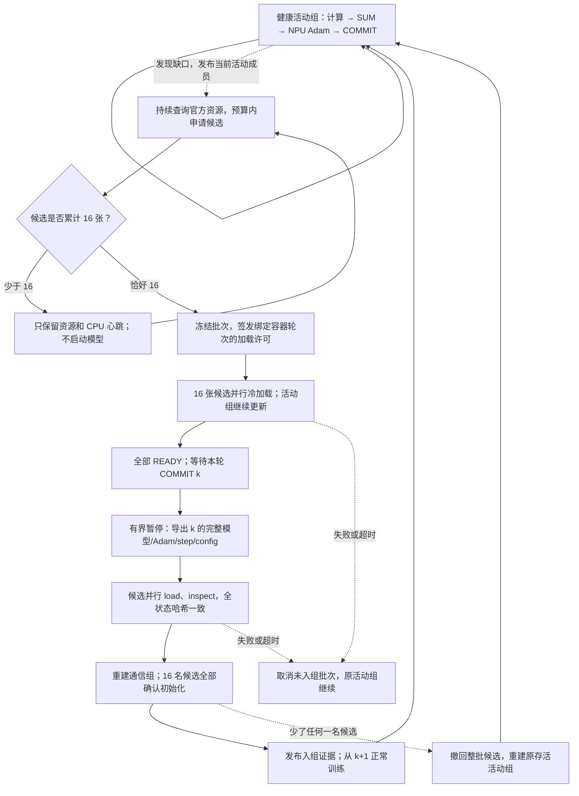

# 累计 16 张后在线补卡

本路径在整组掉卡恢复上增加持续补卡。显式启用 `resident_pod_recovery=true` 和 `resident_pod_refill=true`，使用 `launch.py run` 作为唯一作业驱动。修改前版本已推送至 `backup/pre-batched-refill-20261111`，提交 `f0b37e01316804b5fb4a44b0100d9b8c3e34dab8`；本阶段在 `feature/batched-refill` 分支开发。

## 使用约定

推广完整流程见 [当前策略手册](12_current_ascend_strategy.md)。复制 [48卡初始配置](../config/site.refill.example.json) 或 [完整初始组配置](../config/site.low_priority.example.json) 到项目外，提供自己的 Python/CANN、私有 inventory、共享 registry 和模型 adapter。执行通常的 prepare → verify → run → audit → observe/cleanup。配置中的 `cards` 是本 run 同时持有的物理预算及训练目标，`active_cards` 是初始训练成员数；本模式的 `job_layout` **仅覆盖 active_cards**，之后不修改这份初始布局；动态补卡会向 fleet 历史追加新意图和成员映射。初始成员仍需全部 READY 并完成建组，随后才能使用掉卡恢复与补卡。

```json
{
  "cards": 64,
  "active_cards": 48,
  "job_layout": [16, 16, 16],
  "global_card_limit": 64,
  "training_config": {
    "resident_pod_recovery": true,
    "resident_pod_refill": true,
    "resident_refill_max_batches": 32,
    "resident_refill_candidate_timeout": 1800,
    "resident_refill_max_intents": 512
  }
}
```

这段只是完整站点配置的补卡字段。global batch 固定 256、atomic4、无梯度重算、原生设备 AdamW。OpenPI 沿用已验收的显式模型源码/数据/权重路径，心跳建议先使用 60 秒，RDMA timeout 保持 12；心跳与 RDMA 超时解决不同问题。

初始选择可先使用节点规划功能；后续补卡每轮重新读取官方节点视图，按 CPU、内存和卡数选择合法的 16/8/4/2/1 卡作业。没有空闲容量时，只在物理预算内排队单卡。inventory 保留所有已授权规格；不能伪造新规格、突破空间权限或把计划节点当作实际指定节点。`topology.py watch` 仍只处理固定初始槽位，持续补卡由新配置下的 `launch.py run` 完成。

`topology.py prepare` 可直接用于 `cards=active_cards` 的完整初始组；48初始/64目标需用 `launch.py prepare`，若也要自动规划初始48张，先独立只读 plan48，再把布局与精确 selections 写回正式48/64配置，具体步骤见当前手册。不要直接把上方48/64示例交给 `topology.py prepare`。

OpenPI 使用 `source_dirs` 提供纯源码目录，且 `training_config.openpi_root` 指向同一源目录时，prepare 会将模型根目录重绑到本 run 的冻结副本。不要把它填成上一次 run 的 runtime。启用 `isolate_model_cache` 时，HF dataset 缓存按平台作业分别存放，避免多个主机同时生成同一缓存；不要用共享缓存文件的存在代替完整读取校验。

## 训练与候选分开推进



不足 16 张时，wrapper 只使用标准库维护心跳和门禁。到达 16 张后，许可绑定 run、配置 SHA、不可变申请意图、整批成员和 wrapper session；平台重启产生新 session，旧许可不能再次启动模型。冷加载完成只说明模型进程准备好，仍不能参加梯度归约。

入组只发生在已完成的 COMMIT 边界。当前实现使用共享存储导出一次完整原生 checkpoint，再由候选并行加载；会产生一次有界暂停和读取开销。它不改变每步的梯度传输，也不把 Adam 搬回 CPU。候选模型、Adam 一阶/二阶矩、优化器配置及已完成 step 均需一致，之后才重建全局通信组。同步和入组本身不执行 optimizer update。

如果新组初始化期间候选掉卡，不能把剩下 15 张悄悄接入：撤回该批次，在同一个 k 上恢复原存活组。候选数据损坏、加载错误、失联、资源查询失败及退避只影响补卡；健康模型执行失败、完整状态不一致、恢复预算耗尽仍明确失败。已成功入组后的成员按 [10 的分阶段恢复](10_pod_loss_recovery.md) 处理，不回滚健康权重。

## 物理预算例子

| 活动卡 | 预留/候选 | 行为 |
|---:|---:|---|
| 64 | 0 | 总预算已满；不能额外预占 16 张。 |
| 60 | 4 | 保留 4 张，继续 60 卡训练；不冷加载、不入组。 |
| 48 | 15 | 继续 48 卡训练；15 张只保留资源，等待第 16 张。 |
| 48 | 16 | 冷加载、完整状态同步，通过后恢复到 64 卡。 |
| 40 | 16 | 通过后到 56 卡，下一批只能先预留剩余 8 张。 |
| 0 | 任意 | 已无健康权威副本，明确要求完整 checkpoint 恢复。 |

排队、未知提交、停止尚未确认和保留空闲的卡均占预算。一个 16 卡作业里只失去一个训练进程，不能按平台释放 1 卡处理，也不能为补卡停止同作业内健康成员。作业前缀与训练成员 ID 独立递增：例如新成员可以是 w000065–w000080，同时持有的物理卡仍至多 64。

门槛固定为 16，因此 60 张活动卡加 4 张候选，或 49 张活动卡加 15 张候选，可能长期保持原训练规模。这是减少频繁同步的代价；当前不会为了补齐尾差而提前加载或接入不足 16 张。

只允许控制器在取消与入组互斥的锁内签发候选取消记录；allocator 只能停止有该记录的自有候选作业。已入组批次不能沿用候选取消路径。正常结束会释放未使用候选，launcher 清理覆盖全部动态历史，而非只遍历初始 layout。

## 排障与验收入口

| 文件 | 用途 |
|---|---|
| `refill/progress.json` | 最近更新边界、实际活动成员和目标卡数。 |
| `refill/allocations/<job>.json` | 提交前持久化的不可变 job→训练成员/device 映射。 |
| `refill/reservations/<job>.json` | 无模型预留状态、wrapper incarnation、心跳和设备分配核验。 |
| `refill/state.json` | 当前批次、加载/入组状态、有界历史与拒绝原因。 |
| `refill/permits/`、`refill/admissions/` | 冷加载许可与完成状态同步后的入组证据，二者用途不同。 |
| `refill/cancelled/` | 控制器签发的不可变候选取消授权。 |
| `pod/liveness/` | COMMIT 后压缩活动监控名单，同时保留全部失联隔离记录。 |
| `ascend_fleet/state.json`、`cleanup_receipt.json` | 全部历史作业、未知预留、官方状态和最终释放证明。 |

QZ 的实例 API 有时只返回运行实例与主机，不返回 GPU/NPU ID。此时官方 `allocation_verified` 保持 false；加载门禁另外要求该官方实例名等于 wrapper hostname、观测新鲜、容器设备 mask 或可访问字符设备数量准确。wrapper 不修改 mask、不初始化模型；加载后每个训练进程还检查实际 torch_npu 可见设备数量和自己的逻辑索引。无法核验时继续预留等待。

真实运行数值审计使用完整 run；当前归档审计尚不包含动态补卡的全部映射账本，不可把旧的轻量 toy archive 当作补卡证据。候选从未入组且已获控制器取消的错误可隔离；任何实际训练成员的模型错误均不可忽略。短跑与 CPU 对照不代表长期稳定或下游任务质量，硬件结果另记录在本阶段验收索引。

通用模型可在运行结束且资源释放后执行：

```bash
python -m fragment_training_kit.examples.audit_refill --run-dir /shared/runs/your-refill-run --output /shared/results/your-new-audit.json
```

该审计器只用标准库，核对冻结源码、每步授权/样本覆盖/更新次数、动态成员准入、候选取消、最终完整 checkpoint 字节和所有历史作业终态，并按活动卡数汇总稳定步时。它不会导入模型或替代数值参考。toy 还应单独执行 `examples.audit_toy --run-dir RUN/probe --output NEW_JSON`，以独立 CPU 梯度和 Adam 对照检查数学正确性。

## 2026-11-11 真实验收

验收索引为 [batched-refill-20261111.json](../evidence/batched-refill-20261111.json)。以下三轮都使用真实 QZ LOW 作业，同时持有、预留、排队与未知提交的共享上限为 64；结束后全部历史作业已由官方状态确认终止，剩余资源为 0。

| 实验 | 更新数 | 实际过程 | 结果 |
|---|---:|---|---|
| toy 连续两次掉卡 | 120 | 64→48→64→48→64；COMMIT 42、83 各接入整批 16 张 | 独立 CPU 梯度/Adam 对照通过；参数最大误差 1.19×10⁻⁷，Adam 最大误差 3.49×10⁻⁸。 |
| 不足 16 的对照 | 40 | 49 张训练，另保留恰好 15 张候选 | 无加载许可、候选 supervisor、READY 或训练报告；CPU 数值对照通过。 |
| 原生 OpenPI | 150 | 64 卡初载；归约中停止一个 16 卡作业；48 卡继续；COMMIT 65 接入新 16 张；第 66–150 步使用 64 张 | global batch=256、每卡物理 batch=4、不重算；每步样本覆盖与一次 Adam 更新通过，最终完整状态及 checkpoint 字节审计通过。 |

两轮 toy 的 loss 分别从 4.453125 降至 0.0000320204 和 0.0438514。OpenPI 从 0.0940713 降至 0.00930344，最终 64 个副本的模型、Adam 与配置哈希一致；这不是新的 LIBERO 效果评测。原始审计 SHA、故障记录、准入证据和终态记录分别列在 [toy 证据](../evidence/batched-refill-toy-20261111.json) 与 [OpenPI 证据](../evidence/batched-refill-openpi-20261111.json)。

OpenPI 补入的是 `4+4+2+1+1+1+1+1+1` 共 9 个碎片作业，完成后活动布局为三个 16 卡作业加这 9 个作业。新成员编号达到 w000080；toy 两轮补卡达到 w000096，均未突破同时持有 64 张的物理预算。未加载即取消的候选作业有的平台终态为 `job_failed`，对应 wrapper 退出，不是训练模型执行失败；身份和取消记录均已核验。

### 速度与本阶段边界

| OpenPI 阶段 | 稳定样本数 | 更新间隔中位数 / 均值 | 每步最慢 rank 通信计时中位数 |
|---|---:|---:|---:|
| 48 卡、三个完整 16 卡作业 | 62 | 2.796 / 3.009 秒 | 0.328 秒 |
| 补入碎片后的 64 卡 | 84 | 3.395 / 3.403 秒 | 0.881 秒 |

统计排除了前两步、恢复/成员变动步和补入后的第一个间隔；通信计时包含对端到达与流依赖，不等于纯网络耗时。48 卡阶段的一次 14.36 秒间隔仍保留在均值中。这次 64 卡由更多碎片作业组成，实测通信更慢；不能用这张表宣称补卡本身提高了每步速度，也没有同资源、同时间的原生整组基线。

toy 两次边界暂停分别为 8.114 和 7.788 秒；OpenPI 为 **321.588 秒**，包含约 20.95 GB 完整状态的导出、验证、候选并行加载与检查、通信重建。候选冷加载期间健康组继续推进，最后同步仍需暂停。本阶段减少了同步次数，并完成正确的批量补入，尚未优化这段大模型同步，也未更换每步 HCCL/设备 Adam 后端。

保留了两轮诊断尝试：一轮因官方 API 不返回设备数量而没有签发加载许可，健康组继续了 55 步后受控停止；另一轮在首步前遇到不完整共享 Arrow 缓存。原始错误与释放证据未覆盖，修正后使用新 run 重跑。另保留审计入口把两种 batch 字段混淆的拒绝记录，并通过引擎对应字段及 8 项回归用例修正；不修改原训练记录。

本阶段的真实验收覆盖短跑补卡与已活动作业失联。加载中/建组时的候选失联与撤回由协议测试覆盖；不等于已完成所有故障时点的硬件压力测试，也不等于新的 2,000 步稳定性、20,000 步训练或任务质量结论。

[独立副本验证](../evidence/batched-refill-standalone-20261111.json)另外通过 625 项回归、20 步 CPU 数值参考、两轮历史归档审计与补卡配置的无提交 prepare/verify。运行时清单包含 57 份源码，验证时拒绝回读原项目和原实验目录；之后仅补充证据与文档并重新封包。配置、模型边界和当前限制应与这些真实证据一起阅读。
