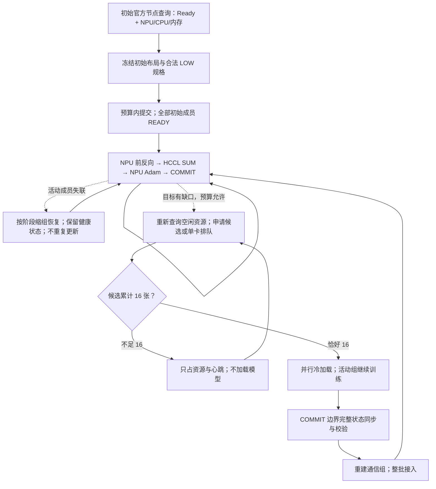

# 当前昇腾低优训练策略与推广使用手册

本页是新使用者和其他 agent 的统一入口，整理截至 2026-11-12 已实现的组合。代码在本独立目录与 GitHub 默认分支 `main` 中，`feature/batched-refill` 保留开发历史；无需原实验目录。当前保持同步训练：候选不能携带旧权重直接参加梯度归约，不启用异步 SGD、DiLoCo 或手工分层通信后端。

## 一次训练如何运行

1. 查询 QZ 官方空间/资源组节点视图，按 Ready、在线状态、空闲 NPU、CPU、内存和合法 LOW 规格规划初始作业。
2. 申请 1/2/4/8/16 卡作业，尽量保留同一作业的完整设备可见域。初始成员全部 READY、首次通信组建立成功后开始训练。
3. 每张 NPU 保存完整模型与原生 AdamW；本地前反向后 HCCL SUM，全局样本覆盖验证通过才授权一次更新，再记录 COMMIT。
4. 掉卡后按已完成阶段封禁旧会话、缩组恢复；只补缺失的样本贡献，或在部分 APPLY 后验证存活者并前进，不能重复执行 Adam。
5. 活动成员低于目标时，在共享预算内持续查询空闲资源、申请候选；没有可用空闲容量时使用合法的单卡排队规格。
6. 候选少于 16 张只保留资源和 CPU 心跳；累计恰好 16 张才并行冷加载。健康活动组此时继续更新。
7. 全部候选 READY 后，在 COMMIT 边界暂停活动组，同步完整模型、Adam、step 和配置，核验并重建通信组；16 张全部通过后，从下一步共同训练。
8. 正常结束或异常清理均覆盖全部动态历史作业，等待官方终态和资源归零。



平台 `running`、候选 `READY` 与正式准入是三个门槛。完整状态同步不执行训练更新。候选失败可取消并重试；健康模型执行错误、完整状态不一致、恢复预算耗尽会明确失败。当前并不保证无停顿恢复，也不支持健康权威副本全部丢失后凭空继续。

## 自动占卡到底依据什么

“网页自动占卡”直接使用官方网页对应的后台 API，不依赖鼠标脚本。已验证的空间为：

- `ws-e5a87523-5ec2-4afa-a14a-56c3f4088d14`
- `ws-8f82eaee-1717-4b74-a6fa-afbc6f231845`

节点查询使用 `ListNodeDimension`，跨空间去重物理节点。优先空闲卡较多的节点，在 CPU、内存、NPU 类型与合法规格约束下选择较大的 16/8/4/2/1 卡作业，而非只看卡数。举例，若 16 卡规格需 160 CPU、8 卡规格需 80 CPU，一个空闲 16 卡但仅余 100 CPU 的节点不能计划该 16 卡规格，可先计划合法 8 卡规格。实际需求以 inventory 中平台提供的规格为准，不能自行拼造规格。

空闲容量用完后，剩余预算可生成 LOW 单卡排队意图；缺少合法单卡规格就无法保证排队补齐。初始 inventory 应保留授权范围内全部所需规格。用 `workspace_ids` 和可选 `allowed_group_ids` 限定空间/资源组；同一账号的本项目实例共享同一 registry。

节点计划只选择资源组与规格，**不保证指定节点落位**。两个空间的历史能力查询为 `train_enable_specified_nodes=false`，计划记录保持 `unbound`；真实容器、节点及设备可见域要在分配后核验。官方实例接口未返回设备数时，保留 `allocation_verified=false`，另用新鲜官方实例名和 wrapper hostname、实际分配 mask/设备节点相互核验；不能把请求卡数当成官方实际分配证据。

当前自动化的范围如下：

| 情况 | 当前行为 |
|---|---|
| 启动前 | `topology.py prepare` 按本轮空闲数据生成并冻结完整初始布局。 |
| 初始作业排队/加载 | 按冻结布局等待；不会自动把未到齐的初始组改成较小训练组。 |
| 训练中有缺口、候选批次正在预留 | `launch.py run` 的 refill 调度重新查询节点，按预算补候选。 |
| 候选不足 16 张 | 只保留资源；本批不启动模型。 |
| 批次已凑齐、正在加载/接入 | 不再往同一批追加申请；活动组等待仅发生在最终同步边界。 |
| 64 张活动卡已占满 64 预算 | 不额外占 16 张；当前不自动迁走健康小作业以整理布局。 |

因此“持续补卡”是有缺口时持续推进，并非始终额外预占资源或无条件扫描换卡。`topology.py watch --fill` 是旧固定初始槽位的补建入口，不是训练中动态补卡驱动；旧 `candidate_watch.py` 也不用于本组合。

## 选择配置

| 使用目的 | 示例 | 起步与入口 |
|---|---|---|
| 第一次核验站点和模型 | [site.example.json](../config/site.example.json) | 2 卡 20 步，先走 README 的普通短跑；无 16 卡补入。 |
| 完整初始组，掉卡后动态补回 | [site.low_priority.example.json](../config/site.low_priority.example.json) | `cards=active_cards=64`；优先用本页 `topology.py prepare` 自动规划。 |
| 先 48 张训练，候选累计 16 张补到 64 | [site.refill.example.json](../config/site.refill.example.json) | `cards=64, active_cards=48`；初始布局仅合计 48，用 `launch.py prepare`。 |
| 历史固定候选切换复现 | [topology.site.example.json](../config/topology.site.example.json) | 旧 deferred standby 路径，不能和 refill 同时开启。 |

关键字段：

| 字段 | 当前含义 |
|---|---|
| `cards` | 本 run 同时持有的物理预算及训练目标；当前补卡组合为 16–64。 |
| `global_card_limit` | 同一 registry 中已登记 fleets 的共享上限，最多 64；不是每个 run 各有 64。 |
| `active_cards` | 初始必须到齐的训练成员数，2–64；恢复后可剩 1 名健康成员。 |
| `job_layout` | refill 模式下只覆盖 `active_cards`，每项为合法 1/2/4/8/16。 |
| `job_selections` | 可选；与初始布局逐项对应的平台已发现规格，由节点规划冻结。 |
| `resident_pod_recovery` / `resident_pod_refill` | 在 `training_config` 中同时为 true，启用当前恢复与补卡组合。 |
| `replacement` | 保持 false；旧单卡 replacement 与本组合分开。 |
| `resident_refill_max_batches` | 有界批次历史上限，示例 32；不是无限重试。 |
| `resident_refill_candidate_timeout` | 每批预留/冷加载生命周期，示例 1800 秒。 |
| `resident_refill_max_intents` | 包括历史作业的申请意图上限，示例 512。 |

本模式不能混用 `resident_topology_slots`、`resident_topology_switches` 或 `defer_standby_until_idle=true`。`budget_scope=registered_fleets` 才支持执行；`account` 当前仅供只读规划。

活动、已预留未加载、候选、排队、未知提交、停止但官方尚未确认的资源都计入预算。60 活动＋4 候选，或 49 活动＋15 候选，可能保持原训练规模；不会为了补尾差而降低 16 卡门槛。历史成员 ID 可以超过 64，同时持有的物理卡仍受预算限制。

## 从独立目录开始执行

以下命令从 `fragment_training_kit/` 的父目录执行。所有 `/shared/...` 均需替换；site、inventory、registry、登录文件和新 run 放在项目之外。Python/CANN 路径需在控制端和作业环境中可用，网络与共享盘由站点提供。

```bash
git clone https://github.com/dongyingyibadao/fragment_training_kit.git fragment_training_kit
python fragment_training_kit/tools/verify_package.py
TORCH_DEVICE_BACKEND_AUTOLOAD=0 python -m fragment_training_kit.examples.audit_toy --cpu-oracle --steps 20 --output /shared/results/toy-oracle-v1.json
```

先按 [平台接入](03_platform_and_resources.md) 准备已有私有登录状态和官方 discovery inventory。需要重新发现规格时，可调用随附只读入口，取得原始发现结果；它不会提交作业，也不会自动核实项目、镜像和 LOW 优先级选择：

```bash
python -c 'import fragment_training_kit; from jade_lotus.ascend_platform import main; raise SystemExit(main())' discover --cookie-file /shared/private/qz.cookies --output /shared/private/raw-discovery.json
```

从原始发现中选取自己的账号、镜像、项目、授权资源组与卡型/CPU/内存规格，核实 LOW/1 映射，再按 [平台接入中的 selectors 示例](03_platform_and_resources.md) 重新发现并生成私有 `verified-ascend-inventory.json`。每项 selection 的 `priority` 必须明确含有 `verified=true`、`level=LOW`、平台返回的 `name` 和 `task_priority`；原始结果中的空值不能直接用于 prepare，也不能仅改文件名作为已验证证据。规划需要可读的共享 registry；首次新建站点、且确实不存在历史 fleet 时，可创建 `{"schema_version":1,"fleets":[]}`。已有 registry 必须沿用，不能清空来获取虚假的预算。登录文件仅由命令行传入，不写进 site 或源码。

### 完整初始组与自动补缺

复制并填写 [site.low_priority.example.json](../config/site.low_priority.example.json)，先保持内置 toy 模型；需要更少初始卡时，`cards`、`active_cards` 与初始 `job_layout` 同时修改。完整初始组的当前补卡组合要求 `16≤cards=active_cards≤64`；2 卡首次验证使用普通配置。本例保持 64/64，实际布局由节点规划替换：

```bash
python fragment_training_kit/topology.py plan --config /shared/private/site-low64.json --output /shared/plans/low64-v1 --cookie-file /shared/private/qz.cookies
python fragment_training_kit/topology.py prepare --config /shared/private/site-low64.json --output /shared/plans/low64-v1 --run-dir /shared/runs/low64-v1 --cookie-file /shared/private/qz.cookies
python fragment_training_kit/launch.py verify --run-dir /shared/runs/low64-v1
python fragment_training_kit/launch.py run --run-dir /shared/runs/low64-v1 --cookie-file /shared/private/qz.cookies --watch-seconds 3000 --interval-seconds 5
```

`plan` 查询并留证，不申请卡；`topology.py prepare` 会再次查询新鲜资源、冻结源码/布局，也不申请卡；真正申请由 `run` 完成。有共享预算占用或缺少合法规格导致初始计划不完整时，prepare 会拒绝，不能偷偷超额。初始可包含排队单卡，必须等初始成员到齐才能训练。运行时长上限与平台 `job_runtime_seconds` 应覆盖排队、初载、训练、恢复及最终保存；短示例的时长不能直接照搬到 20,000 步。

### 48 卡先起、16 卡成批补入

使用 [site.refill.example.json](../config/site.refill.example.json)，其初始 `[16,16,16]` 只覆盖 48 张。按这个已确认的授权布局启动：

```bash
python fragment_training_kit/launch.py prepare --config /shared/private/site-refill48.json --run-dir /shared/runs/refill48-v1
python fragment_training_kit/launch.py verify --run-dir /shared/runs/refill48-v1
python fragment_training_kit/launch.py run --run-dir /shared/runs/refill48-v1 --cookie-file /shared/private/qz.cookies --watch-seconds 3000 --interval-seconds 5
```

这条 `launch.py prepare` 不会自行按节点重排初始 48 张；训练中补候选才重新查询空闲节点。当前不能把这个 48/64 配置直接交给 `topology.py prepare`：该入口要求计划覆盖 `cards`，而 refill 初始布局必须只覆盖 `active_cards`。

若初始 48 张也需自动按空闲资源选择，使用单独的只读 planning site（`cards=active_cards=48`、`global_card_limit=64`，其余授权范围相同），执行 `topology.py plan`。检查最新批次 `plan.json` 的完整布局合计 48、节点观测新鲜、预算与诊断正常，然后将 `job_layout` 和 `placements` 中逐项 `selection` 作为正式 48/64 site 的 `job_layout`、`job_selections`，再 `launch.py prepare`。正式 inventory 保留完整授权的 1/2/4/8/16 规格；不把规划配置的 `cards=48` 当作最终目标。只复制精确 selection，不把计划节点伪装成绑定请求。

120 步 toy 可能在候选启动前完成。验证入组需要留足候选排队与加载时间；训练完成但没有 admission，只能算正常训练通过，不能算补卡成功。真实已完成的补卡/不加载对照见本页证据表。

## 接入自己的模型或 OpenPI

通用模型按 [02 模型接入](02_adapting_your_model.md) 实现 `module:factory` adapter，显式提供 `source_dirs`。训练合同仍为 global256、atomic4、无重算、原生 AdamW；每个样本先乘 1/256，设备做 SUM，不再除当前卡数。缩组时每卡可处理多个 atomic4 单元。

OpenPI 使用 [案例字段模板](../config/openpi.case.template.json)；用该对象替换 site 的 toy `training_config`，再补上 `resident_pod_recovery=true` 和 `resident_pod_refill=true`。删除 toy 的 `resident_adapter`、RNG/精度声明和学习率配方，不将 toy 的高学习率带入 OpenPI。`site.steps` 与 `target_steps` 对齐，学习率/warmup/decay按自己的正式配方设置。

提供已适配的 OpenPI 源码、基座权重、数据与 tokenizer；将纯源码根目录放入 `source_dirs`，并使 `openpi_root` 等于该目录，prepare 才会重绑到本次冻结副本。不要引用上一次 run 的 runtime。建议 OpenPI 显式设置 `isolate_model_cache=true`，HF dataset 缓存将按平台作业隔离，避免不同节点并发生成同一缓存；这并不替代版本与数据完整性检查。

通用 adapter 的物理 batch 字段是 `worker_microbatch_size`；OpenPI 原生路径读取 `microbatch_size`。64 卡每卡 4 样本时设为 4；恢复到 48 张后每卡负载可能不同，但 global batch 仍为 256。不能把“每卡 batch4”理解为缩组后仍只处理 48×4 个样本。

## 监控、审计与清理

```bash
python fragment_training_kit/launch.py observe --run-dir /shared/runs/low64-v1 --cookie-file /shared/private/qz.cookies
python -m fragment_training_kit.examples.audit_refill --run-dir /shared/runs/low64-v1 --output /shared/results/low64-protocol-v1.json
TORCH_DEVICE_BACKEND_AUTOLOAD=0 python -m fragment_training_kit.examples.audit_toy --run-dir /shared/runs/low64-v1/probe --output /shared/results/low64-toy-v1.json
```

审计在训练完成且资源释放后执行；输出用新文件名。第二条是通用协议/完整 checkpoint 字节审计，不导入模型；第三条仅用于 toy，另核对独立 CPU 梯度与 Adam 数值参考。不能用 toy oracle 验证任意大模型梯度，也不能把 `audit_refill` 的哈希一致称为独立数学对照。

| 记录 | 观察内容 |
|---|---|
| `launcher_status.json`、`ascend_fleet/state.json` | 全部历史作业、申请预留、running/pending、官方状态。 |
| `refill/placement-latest.json` | 最近补卡节点观测、候选布局和预算；满组无新规划时可无此文件。 |
| `refill/progress.json`、`refill/state.json` | 已提交步、活动成员、候选批次阶段。 |
| `refill/permits/`、`refill/admissions/` | 加载许可和正式准入分别留证；二者不能混用。 |
| `probe/commits.jsonl`、`probe/summary.json` | 完整更新序列、恢复/准入、最终状态；长跑 summary 可能只保留提交尾部。 |
| `cleanup_receipt.json` | `resources_released=true`，活动作业及本地预留均为 0。 |

正常结束由 launcher 收尾。需要中止或确认异常释放时，仅清理这个 run：

```bash
python fragment_training_kit/launch.py cleanup --run-dir /shared/runs/low64-v1 --cookie-file /shared/private/qz.cookies
```

本地退出不等于平台释放；没有官方终态和零预留回执就继续检查。保留失败 run 和最早错误，新尝试使用新路径；不停止无关作业，不清空共享账本。实验前按站点约定检查保活，使用任务自己的暂停文件并在收尾移除，保留监控父进程。

## 已验证结果与当前限制

| 证据 | 验证内容 | 可用于什么判断 |
|---|---|---|
| [当前补卡验收索引](../evidence/batched-refill-20261111.json) | 三轮真实 LOW、global256、无重算；所有历史资源释放。 | 当前组合的短跑正确性与生命周期。 |
| [toy 两轮证据](../evidence/batched-refill-toy-20261111.json) | 120 步两次 64→48→64；40 步恰好 15 张只预留；独立 CPU 数值通过。 | 补卡更新正确、16 张门槛真实生效。 |
| [OpenPI 补卡](../evidence/batched-refill-openpi-20261111.json) | 150 步，64→48→64，COMMIT65 补入；loss 0.0941→0.00930，完整状态一致。 | 原生 OpenPI 可使用当前短跑流程。 |
| [独立副本](../evidence/batched-refill-standalone-20261111.json) | 625 测试、57 runtime 源码、CPU 参考与无提交准备通过，禁止读取原目录。 | 代码与接入边界可独立复用。 |
| [历史长跑与 LIBERO](05_evidence_and_limits.md) | 较早独立单卡路径完成 20,000 步，LIBERO 1899/2000。 | 历史模型训练效果；不是新补卡路径的长期验收。 |

上述 OpenPI 短跑补入的 16 张来自 9 个碎片作业 `4+4+2+1+1+1+1+1+1`。稳定更新间隔中位数：48 卡约 2.796 秒，补入后 64 卡约 3.395 秒；碎片通信开销更高，补卡不保证每步一定更快。入组完整同步暂停 321.588 秒，状态约 20.95 GB；候选冷加载期间原组继续训练。总时间必须加上排队、初载、编译、故障、同步及最终保存，不能只用稳定步时乘步数。

当前使用默认 HCCL SUM，保留完整作业设备域让 HCCL 选择可用机内/跨机通路；手工两级通信仅为 [09](09_topology_training.md) 的独立基准，尚未作为恢复后端。历史同批 4×16 设备上手工分层反而更慢；`HCCL_RDMA_TIMEOUT=12` 也不是任意布局的最佳值。

全员失联、controller 崩溃自动续跑、启动阶段任意成员失联、任意硬件故障无损恢复、FSDP/ZeRO/分片优化器、任意 batch/optimizer、同步零暂停均未获得本项目保证。完整 checkpoint 新 run 恢复仍需显式绑定原 source spec，launcher 没有一键 resume。进一步改变算法或精度，需要单独验收；目前保留同步方案。

本页及新增完整初始组配置是推广整理，不新增一轮训练成绩。[整理验证记录](../evidence/strategy-guide-verification-20261112.json) 包含配置/链接检查、三种无提交 prepare/verify 和源码一致性检查。历史 [09](09_topology_training.md)/[10](10_pod_loss_recovery.md) 保留各自版本边界，当前恢复与补入以 [11](11_batched_refill.md) 及本页为准。
